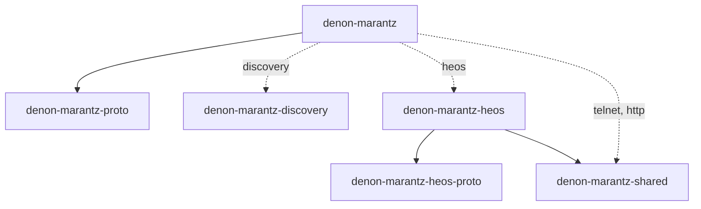
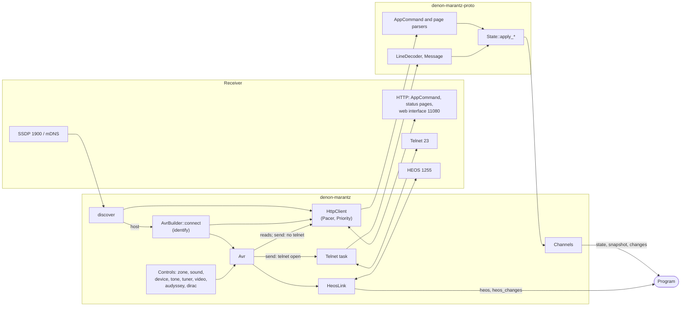

# Architecture

## Crates

The `*-proto` crates and `denon-marantz-discovery` have no IO. They parse and
build messages. The other crates do the IO with tokio.

Dashed arrows are optional dependencies. The label lists the features of
`denon-marantz` that turn them on directly. Any one of the listed features is
enough. `discovery`, `heos` and `mdns` turn on `http`, and `mdns` turns on
`discovery`.

## Data flow in `denon-marantz`

1. `discover` finds receivers with SSDP. With the `mdns` feature,
   `discover_all` uses mDNS too. The program passes the host of a found
   receiver to `Avr::builder`.
2. `AvrBuilder::connect` reads `Deviceinfo.xml` and the device description
   over HTTP to find the kind of receiver, its HTTP port, brand and model.
   With `AvrBuilder::known` it sends no request.
3. `Avr::start` reads the zones over HTTP. Telnet and the other HTTP reads
   fill in the rest in the background.
4. Every receiver value goes through `Channels`, which keeps the `State` and
   sends a `Change` for each change. HEOS has its own state and its own
   changes.
5. Commands use telnet while it is open, and HTTP otherwise.

`discover` needs the `discovery` feature, the telnet task needs `telnet`, and
`Avr::heos` needs `heos` and a receiver with HEOS.

